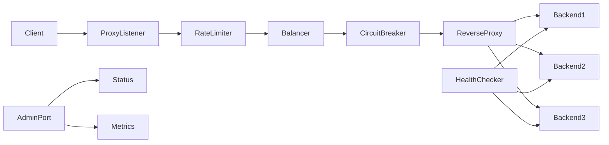

# loadbear

A small, friendly load balancer written in Go.

[](https://github.com/weaztoven/loadbear/actions/workflows/ci.yml)
[](https://goreportcard.com/report/github.com/weaztoven/loadbear)
[](LICENSE)
[](https://pkg.go.dev/github.com/weaztoven/loadbear)

## Why loadbear?

loadbear is a small, dependency-light HTTP reverse proxy that distributes requests across configured backends. It is designed to be easy to run locally, inspect, and extend without a large framework or monitoring stack.

## Features

- Reverse proxy to configured HTTP(S) backends.
- Round robin, smooth weighted round robin, least connections, and IP hash selection.
- Periodic active health checks and passive health changes after proxy errors.
- Retries for GET, HEAD, and OPTIONS requests on upstream errors.
- Configurable, request-context-aware delay between retry attempts.
- Per-backend circuit-breaker state.
- Per-client-IP token-bucket rate limiting with periodic eviction of idle client buckets.
- Structured access logs with request ID, client, backend, response status, and latency.
- YAML configuration; `LOADBEAR_LISTEN` and `LOADBEAR_LOG_LEVEL` override their YAML values.
- Separate admin listener with `/status` and `/metrics`.
- Graceful server shutdown on SIGINT and SIGTERM.
- Multi-stage Docker images and a Docker Compose demo.

## Quick start

### From source

Start three fake backends, each in its own terminal:

```powershell
go run ./cmd/fakebackend --port 8081 --name b1
```

```powershell
go run ./cmd/fakebackend --port 8082 --name b2
```

```powershell
go run ./cmd/fakebackend --port 8083 --name b3
```

The same commands work in Linux and macOS shells. In a fourth terminal, start loadbear:

```sh
go run ./cmd/loadbear --config examples/config.example.yaml
```

Alternatively, `make build` writes `loadbear` and `fakebackend` into the repository root (`loadbear.exe` and `fakebackend.exe` on Windows). Run `./loadbear --config examples/config.example.yaml` on Linux/macOS or `.\loadbear.exe --config examples/config.example.yaml` in PowerShell.

### Docker

Build either image target:

```sh
docker build --target loadbear -t loadbear .
docker build --target fakebackend -t fakebackend .
```

The loadbear image reads `/etc/loadbear/config.yaml`; when running it directly, provide a config whose backend URLs resolve on the container's network. The Docker config example uses the Compose service names.

### Docker Compose

Run the load balancer and its three backends together:

```sh
docker compose up --build
```


## Architecture



Requests arrive on the proxy listener, pass through rate limiting and backend selection, and are forwarded through Go's `httputil.ReverseProxy`. The health checker probes configured backend health paths. The separate admin listener serves status and metrics.

## Configuration reference

Durations accept Go duration strings such as `"10s"` or integer seconds. Defaults below come from `internal/config.DefaultConfig`. A backend list is required to start the application; each backend URL and positive weight must be provided.

| Field | Type | Default | Description |
|---|---|---|---|
| `listen` | string | `:8080` | Proxy HTTP listen address. Overridden by `LOADBEAR_LISTEN`. |
| `admin_listen` | string | `:9090` | Admin HTTP listen address. |
| `log_level` | string | `info` | Log verbosity: `debug`, `info`, `warn`, or `error`. Overridden by `LOADBEAR_LOG_LEVEL`. |
| `log_format` | string | `json` | `json` selects JSON logging; other values use text logging. |
| `strategy` | string | `round_robin` | Backend selection: `round_robin`, `smooth_weighted_round_robin`, `least_connections`, or `ip_hash`. |
| `backends` | list | required | Backend list. |
| `backends[].url` | URL string | required | Backend HTTP(S) base URL. |
| `backends[].weight` | integer | required | Positive backend weight; used by smooth weighted round robin. |
| `health.path` | string | `/health` | Active health-check path. |
| `health.interval` | duration | `10s` | Time between health-check rounds. |
| `health.timeout` | duration | `2s` | Per-check HTTP client timeout. |
| `health.healthy_threshold` | integer | `2` | Consecutive successful checks before restoring a down backend. |
| `health.unhealthy_threshold` | integer | `2` | Consecutive failed checks before marking a backend down. Proxy errors also mark a backend down. |
| `proxy.max_idle_conns` | integer | `100` | Transport-wide idle connection limit. |
| `proxy.max_idle_conns_per_host` | integer | `50` | Per-host idle connection limit. |
| `proxy.idle_conn_timeout` | duration | `90s` | Idle transport connection timeout. |
| `proxy.response_header_timeout` | duration | `10s` | Upstream response-header timeout. |
| `proxy.tls_handshake_timeout` | duration | `10s` | Upstream TLS handshake timeout. |
| `proxy.dial_timeout` | duration | `5s` | Upstream connection dial timeout. |
| `proxy.request_timeout` | duration | `30s` | HTTP server read and write timeout setting. |
| `proxy.retry_max_attempts` | integer | `2` | Maximum total attempts for eligible requests, including the first selection. |
| `proxy.retry_backoff` | duration | `100ms` | Delay between retry attempts; waiting stops when the request context is cancelled. |
| `proxy.circuit_failure_threshold` | integer | `5` | Consecutive failures before opening a backend circuit. |
| `proxy.circuit_cooldown` | duration | `30s` | Time an open circuit waits before allowing a half-open probe. |
| `rate_limit.enabled` | boolean | `true` | Enable per-client-IP request limiting. |
| `rate_limit.rate` | number | `100` | Token refill rate per second. |
| `rate_limit.burst` | integer | `200` | Maximum token bucket size. |
| `rate_limit.window` | duration | `1m` | Used for Retry-After, stale bucket age, and the interval for periodic stale-bucket eviction (half this duration). |
| `rate_limit.trusted_proxy` | boolean | `false` | Trust the first address in `X-Forwarded-For` for client IP derivation. |
| `shutdown.grace_period` | duration | `15s` | Grace period used during HTTP server shutdown. |

See [examples/config.example.yaml](examples/config.example.yaml) and [examples/config.docker.yaml](examples/config.docker.yaml).

## Algorithm comparison

| Strategy | Selection behavior | Uses weights | Client affinity |
|---|---|---:|---|
| `round_robin` | Cycles across currently eligible backends. | No | No |
| `smooth_weighted_round_robin` | Smoothly distributes selections in proportion to backend weights. | Yes | No |
| `least_connections` | Selects the eligible backend with the fewest active proxied connections. | No | No |
| `ip_hash` | Hashes the client IP to select an eligible backend. | No | Yes, for a stable backend list |

Unhealthy or circuit-open backends are excluded by selection.

## Admin endpoints

The admin listener defaults to port `9090`; these paths are not registered on the proxy listener.

`GET /status` returns backend state. Example shape:

```json
{
  "backends": [
    {
      "url": "http://127.0.0.1:8081",
      "name": "127.0.0.1:8081",
      "healthy": true,
      "active_connections": 0,
      "total_requests": 0,
      "total_failures": 0,
      "circuit_state": "closed",
      "weight": 1
    }
  ]
}
```

`GET /metrics` returns Prometheus text. Example output from an idle process:

```text
# HELP loadbear_requests_total Total number of proxied requests.
# TYPE loadbear_requests_total counter
loadbear_requests_total 0
# HELP loadbear_failures_total Total number of failing requests.
# TYPE loadbear_failures_total counter
loadbear_failures_total 0
# HELP loadbear_request_latency_seconds Request latency in seconds.
# TYPE loadbear_request_latency_seconds histogram
loadbear_request_latency_seconds_bucket{le="0.005"} 0
loadbear_request_latency_seconds_bucket{le="0.010"} 0
loadbear_request_latency_seconds_bucket{le="+Inf"} 0
# HELP loadbear_backend_up Backend health gauge.
# TYPE loadbear_backend_up gauge
loadbear_backend_up{name="127.0.0.1:8081"} 1
```

For example, query them at `http://localhost:9090/status` and `http://localhost:9090/metrics`.

## Demo

Start the three fake backends and loadbear as shown in [Quick start](#quick-start). Send requests repeatedly:

Linux/macOS:

```sh
for i in 1 2 3 4 5 6; do curl -s http://localhost:8080/; done
```

PowerShell (use `curl.exe` to invoke curl rather than the PowerShell alias):

```powershell
1..6 | ForEach-Object { curl.exe -s http://localhost:8080/ }
```

Each fake backend responds with JSON identifying its name and request path. To observe failover, stop one fake backend (press Ctrl+C in its terminal, or stop its process using your shell's normal process controls), then continue sending requests. Proxy errors mark a backend down and eligible requests can be retried on another backend. Once all backend health states are down, the proxy returns `503 Service Unavailable` with a plain-text body. Active health checks may take multiple intervals to restore a backend.

## Testing

Run the tests and race detector:

```sh
go test ./...
go test -race ./...
```

Get per-package coverage:

```sh
go test -cover ./internal/...
```

Or use `make cover` for a coverage profile and function summary. CI also runs formatting, vet, race-enabled tests with coverage, and build checks.

## Known limitations and roadmap

- WebSocket upgrades are not verified and should be treated as unsupported; current hop-by-hop header handling removes `Upgrade`.
- SIGHUP hot reload is not implemented.
- Metrics are a small hand-written Prometheus text endpoint, not a complete Prometheus client implementation.
- Load/performance benchmarks and WebSocket integration tests are not currently provided.

## Contributing

See [CONTRIBUTING.md](CONTRIBUTING.md) for the contribution workflow and testing expectations.

## License

MIT. See [LICENSE](LICENSE).
