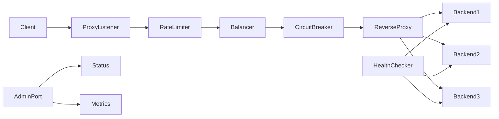

# loadbear

A small, friendly load balancer written in Go.

[](https://github.com/weaztoven/loadbear/actions/workflows/ci.yml)
[](LICENSE)
[](https://pkg.go.dev/github.com/weaztoven/loadbear)

## Why loadbear?

loadbear is a small, dependency-light HTTP reverse proxy that distributes requests across configured backends. It is designed to be easy to run locally, inspect, and extend without a large framework or monitoring stack.

## Features

- Reverse proxy to configured HTTP(S) backends.
- Round robin, smooth weighted round robin, least connections, and IP hash selection.
- Periodic active health checks and passive health changes after proxy errors.
- Retries for GET, HEAD, and OPTIONS requests on upstream errors when the body is absent or replayable, only before response headers are committed, and within the original request context.
- Configurable, request-context-aware delay between retry attempts.
- Per-backend circuit-breaker state.
- Per-client-IP token-bucket rate limiting with periodic eviction of idle client buckets.
- Structured access logs with request ID, client, backend, response status, and latency.
- YAML configuration; `LOADBEAR_LISTEN` and `LOADBEAR_LOG_LEVEL` override their YAML values.
- On Linux and macOS, SIGHUP reloads the backend list, selection strategy, and health-check settings without interrupting in-flight proxy requests.
- Separate admin listener with `/status` and `/metrics`.
- Optional `net/http/pprof` handlers on the admin listener only.
- Graceful server shutdown on SIGINT and SIGTERM.
- Multi-stage Docker images and a Docker Compose demo.

## Quick start

### From source

Start three fake backends, each in its own terminal:

```powershell
go run ./cmd/fakebackend --port 8081 --name b1
```

```powershell
go run ./cmd/fakebackend --port 8082 --name b2
```

```powershell
go run ./cmd/fakebackend --port 8083 --name b3
```

The same commands work in Linux and macOS shells. In a fourth terminal, start loadbear:

```sh
go run ./cmd/loadbear --config examples/config.example.yaml
```

Alternatively, `make build` writes `loadbear` and `fakebackend` into the repository root (`loadbear.exe` and `fakebackend.exe` on Windows). Run `./loadbear --config examples/config.example.yaml` on Linux/macOS or `.\loadbear.exe --config examples/config.example.yaml` in PowerShell.

### Docker

Build either image target:

```sh
docker build --target loadbear -t loadbear .
docker build --target fakebackend -t fakebackend .
```

The loadbear image reads `/etc/loadbear/config.yaml`; when running it directly, provide a config whose backend URLs resolve on the container's network. The Docker config example uses the Compose service names.

### Docker Compose

Run the load balancer and its three backends together:

```sh
docker compose up --build
```

## Architecture



Requests arrive on the proxy listener, pass through rate limiting and backend selection, and are forwarded through Go's `httputil.ReverseProxy`. The health checker probes configured backend health paths. The separate admin listener serves status and metrics.

## Configuration reference

Durations accept Go duration strings such as `"10s"` or integer seconds. Defaults below come from `internal/config.DefaultConfig`. A backend list is required to start the application; each backend URL and positive weight must be provided.

| Field | Type | Default | Description |
|---|---|---|---|
| `listen` | string | `:8080` | Proxy HTTP listen address. Overridden by `LOADBEAR_LISTEN`. |
| `admin_listen` | string | `127.0.0.1:9090` | Admin HTTP listen address. Docker config overrides this to `:9090` inside its container. |
| `admin.pprof_enabled` | boolean | `false` | Register Go runtime profiling handlers on the admin listener only. Keep the admin listener private. |
| `log_level` | string | `info` | Log verbosity: `debug`, `info`, `warn`, or `error`. Overridden by `LOADBEAR_LOG_LEVEL`. |
| `log_format` | string | `json` | `json` selects JSON logging; other values use text logging. |
| `strategy` | string | `round_robin` | Backend selection: `round_robin`, `smooth_weighted_round_robin`, `least_connections`, or `ip_hash`. |
| `backends` | list | required | Backend list. |
| `backends[].url` | URL string | required | Backend HTTP(S) base URL. |
| `backends[].weight` | integer | required | Positive backend weight; used by smooth weighted round robin. |
| `health.path` | string | `/health` | Active health-check path. |
| `health.interval` | duration | `10s` | Time between health-check rounds. |
| `health.timeout` | duration | `2s` | Per-check HTTP client timeout. |
| `health.healthy_threshold` | integer | `2` | Consecutive successful checks before restoring a down backend. |
| `health.unhealthy_threshold` | integer | `2` | Consecutive failed checks before marking a backend down. Proxy errors also mark a backend down. |
| `proxy.max_idle_conns` | integer | `100` | Transport-wide idle connection limit. |
| `proxy.max_idle_conns_per_host` | integer | `50` | Per-host idle connection limit. |
| `proxy.idle_conn_timeout` | duration | `90s` | Idle transport connection timeout. |
| `proxy.response_header_timeout` | duration | `10s` | Upstream response-header timeout. |
| `proxy.tls_handshake_timeout` | duration | `10s` | Upstream TLS handshake timeout. |
| `proxy.dial_timeout` | duration | `5s` | Upstream connection dial timeout. |
| `proxy.request_timeout` | duration | `30s` | HTTP server read and write timeout setting; a client request context/deadline also bounds all upstream attempts and backoff. |
| `proxy.retry_max_attempts` | integer | `2` | Maximum total attempts for eligible requests, including the first selection. Retried requests must have no body or a `GetBody` replay function. |
| `proxy.retry_backoff` | duration | `100ms` | Delay between retry attempts; waiting stops when the request context is cancelled. |
| `proxy.circuit_failure_threshold` | integer | `5` | Consecutive transport failures or response failures before opening a backend circuit; opt-in tunnel errors use their own consecutive-error streak. |
| `proxy.circuit_cooldown` | duration | `30s` | Time an open circuit waits before allowing one half-open probe. |
| `proxy.circuit_failure_statuses` | list of integers | `[]` | Adds statuses to the default rule that every upstream 5xx counts as a breaker failure; it does not replace that rule. Listed statuses may be retried only for eligible GET/HEAD/OPTIONS requests with an absent or replayable body when another backend is available and no response is committed. A 5xx always counts, even when this list is empty; 429 and 404 do not count unless listed. Response statuses do not mark a backend unhealthy. Startup-only. |
| `proxy.circuit_count_tunnel_errors` | boolean | `false` | Opt in to breaker failures for upstream tunnel I/O errors only. Clean upstream closes, client closes, shutdown-forced closes, and unknown outcomes never count. Does not retry or mark a backend unhealthy; the 101 handshake remains a success. Startup-only. |
| `rate_limit.enabled` | boolean | `true` | Enable per-client-IP request limiting. |
| `rate_limit.rate` | number | `100` | Token refill rate per second. |
| `rate_limit.burst` | integer | `200` | Maximum token bucket size. |
| `rate_limit.window` | duration | `1m` | Used for Retry-After, stale bucket age, and the interval for periodic stale-bucket eviction (half this duration). |
| `rate_limit.trusted_proxies` | list of IPs/CIDRs | `[]` | Trust `X-Forwarded-For` only when the direct peer IP is in this list. Empty means never trust the header. |
| `shutdown.grace_period` | duration | `15s` | Grace period used during HTTP server shutdown. |

See [examples/config.example.yaml](examples/config.example.yaml) and [examples/config.docker.yaml](examples/config.docker.yaml).

With the default empty `proxy.circuit_failure_statuses`, upstream 500, 502, and 503 responses contribute to the breaker-failure threshold but do not mark the backend unhealthy or trigger status-based retries. Listing a status opts that response into the retry rules described above. Transport errors mark the backend unhealthy and may be retried under the existing retry rules.

## Reloading configuration

On Linux and macOS, send SIGHUP to reload and validate the config file used at startup:

```sh
kill -HUP <pid>
```

In Docker, signal the running container:

```sh
docker kill --signal=HUP <container>
```

The backend list (URLs and weights), selection strategy, and health-check settings (`health.path`, `health.interval`, `health.timeout`, `health.healthy_threshold`, and `health.unhealthy_threshold`) are reloaded. Backends with unchanged URLs keep their health flag, counters, and circuit-breaker state. If health settings change, loadbear cancels and waits for the old checker before starting a replacement; its per-backend consecutive check streaks reset, while each reused backend's health flag is preserved. An in-flight check canceled during this replacement is not recorded as a failure. In-flight proxy requests to removed backends are allowed to finish. Invalid configuration is rejected and the old settings remain active; bursts of SIGHUP are coalesced.

All other settings are startup-only and require a restart, including proxy/admin listen addresses, proxy timeouts and retry/circuit-breaker settings (including `proxy.circuit_failure_statuses`), rate limiting, and logging. SIGHUP reload is not available on Windows.

## Graceful shutdown

On SIGINT or SIGTERM, loadbear stops accepting new work and allows regular HTTP requests to drain during `shutdown.grace_period`. `http.Server.Shutdown` does not track hijacked connections, so the proxy handler separately tracks upgraded tunnels. It waits for active tunnels to close for the remaining grace period; if the deadline expires, it closes the remaining client-side tunnel connections, logs the number force-closed, and waits for tunnel cleanup so backend active-connection counters and access logs are finalized. Normal requests are unaffected by tunnel tracking.

## Algorithm comparison

| Strategy | Selection behavior | Uses weights | Client affinity |
|---|---|---:|---|
| `round_robin` | Cycles across currently eligible backends. | No | No |
| `smooth_weighted_round_robin` | Smoothly distributes selections in proportion to backend weights. | Yes | No |
| `least_connections` | Selects the eligible backend with the fewest active proxied connections. | No | No |
| `ip_hash` | Hashes the client IP to select an eligible backend. | No | Yes, for a stable backend list |

Unhealthy or circuit-open backends are excluded by selection.

## Admin endpoints

The admin listener defaults to port `9090`; `/status`, `/metrics`, and optional pprof paths are not registered on the proxy listener.

The `/status` endpoint exposes backend URLs and topology. Keep the admin listener private and do not expose `/status` publicly; the default bind is loopback. Docker's example binds inside the container, while Compose publishes the host admin port only on `127.0.0.1`.

`GET /status` returns backend state. Example shape:

```json
{
  "backends": [
    {
      "url": "http://127.0.0.1:8081",
      "name": "127.0.0.1:8081",
      "healthy": true,
      "active_connections": 0,
      "total_requests": 0,
      "total_failures": 0,
      "circuit_state": "closed",
      "weight": 1
    }
  ]
}
```

`GET /metrics` returns Prometheus text with cumulative request- and tunnel-duration buckets, `_sum`/`_count`, per-backend request/failure counters, active connection/tunnel and circuit-state gauges, a rate-limited counter, and per-backend tunnel-close counters. Per-backend request and failure counters include upstream attempts; global request and latency series describe the final proxied request result, while rate-limited requests have their own counter. Emitted tunnel close reasons are `client_closed`, `upstream_closed`, `upstream_error`, `shutdown_forced`, and `unknown`. `shutdown_forced` is explicit; `client_closed`, `upstream_closed`, and `upstream_error` are best-effort classifications based on observed TCP EOFs or upstream I/O errors. Client-side I/O errors and ambiguous outcomes are `unknown`. Backend label values are escaped, and backend series are sorted for stable output.

Go profiling is disabled by default. Set `admin.pprof_enabled: true` to enable `GET /debug/pprof/` and its standard profile handlers on the admin listener. These endpoints can expose runtime and application details and consume resources while collecting profiles; never expose the admin listener or pprof endpoints publicly.

This example is generated by `TestPrometheusHistogramIsCumulativeAndIncludesSumAndCount` with three request observations (8 ms, 20 s, and 5 ms), two attributed to the backend, plus one 75-second upstream-error tunnel:

```text
# HELP loadbear_requests_total Total number of proxied requests.
# TYPE loadbear_requests_total counter
loadbear_requests_total 3
# HELP loadbear_failures_total Total number of failing requests.
# TYPE loadbear_failures_total counter
loadbear_failures_total 2
# HELP loadbear_rate_limited_total Total number of rate-limited requests.
# TYPE loadbear_rate_limited_total counter
loadbear_rate_limited_total 0
# HELP loadbear_request_latency_seconds Request latency in seconds.
# TYPE loadbear_request_latency_seconds histogram
loadbear_request_latency_seconds_bucket{le="0.001"} 0
loadbear_request_latency_seconds_bucket{le="0.0025"} 0
loadbear_request_latency_seconds_bucket{le="0.005"} 1
loadbear_request_latency_seconds_bucket{le="0.01"} 2
loadbear_request_latency_seconds_bucket{le="0.025"} 2
loadbear_request_latency_seconds_bucket{le="0.05"} 2
loadbear_request_latency_seconds_bucket{le="0.1"} 2
loadbear_request_latency_seconds_bucket{le="0.25"} 2
loadbear_request_latency_seconds_bucket{le="0.5"} 2
loadbear_request_latency_seconds_bucket{le="1"} 2
loadbear_request_latency_seconds_bucket{le="2.5"} 2
loadbear_request_latency_seconds_bucket{le="5"} 2
loadbear_request_latency_seconds_bucket{le="10"} 2
loadbear_request_latency_seconds_bucket{le="+Inf"} 3
loadbear_request_latency_seconds_sum 20.013
loadbear_request_latency_seconds_count 3
# HELP loadbear_backend_up Backend health gauge.
# TYPE loadbear_backend_up gauge
loadbear_backend_up{backend="http://127.0.0.1:8081"} 1
# HELP loadbear_backend_requests_total Total requests sent to each backend.
# TYPE loadbear_backend_requests_total counter
loadbear_backend_requests_total{backend="http://127.0.0.1:8081"} 2
# HELP loadbear_backend_failures_total Total failed requests for each backend.
# TYPE loadbear_backend_failures_total counter
loadbear_backend_failures_total{backend="http://127.0.0.1:8081"} 1
# HELP loadbear_backend_active_connections Active backend connections.
# TYPE loadbear_backend_active_connections gauge
loadbear_backend_active_connections{backend="http://127.0.0.1:8081"} 1
# HELP loadbear_circuit_state Backend circuit state (0 closed, 1 open, 2 half-open).
# TYPE loadbear_circuit_state gauge
loadbear_circuit_state{backend="http://127.0.0.1:8081"} 0
# HELP loadbear_active_tunnels Total number of active upgraded tunnels.
# TYPE loadbear_active_tunnels gauge
loadbear_active_tunnels 0
# HELP loadbear_backend_active_tunnels Active upgraded tunnels per backend.
# TYPE loadbear_backend_active_tunnels gauge
loadbear_backend_active_tunnels{backend="http://127.0.0.1:8081"} 0
# HELP loadbear_tunnel_duration_seconds Duration of completed upgraded tunnels in seconds.
# TYPE loadbear_tunnel_duration_seconds histogram
loadbear_tunnel_duration_seconds_bucket{le="1"} 0
loadbear_tunnel_duration_seconds_bucket{le="5"} 0
loadbear_tunnel_duration_seconds_bucket{le="15"} 0
loadbear_tunnel_duration_seconds_bucket{le="60"} 0
loadbear_tunnel_duration_seconds_bucket{le="300"} 1
loadbear_tunnel_duration_seconds_bucket{le="900"} 1
loadbear_tunnel_duration_seconds_bucket{le="3600"} 1
loadbear_tunnel_duration_seconds_bucket{le="+Inf"} 1
loadbear_tunnel_duration_seconds_sum 75
loadbear_tunnel_duration_seconds_count 1
# HELP loadbear_tunnel_closed_total Total number of closed upgraded tunnels by backend and reason.
# TYPE loadbear_tunnel_closed_total counter
loadbear_tunnel_closed_total{backend="http://127.0.0.1:8081",reason="client_closed"} 0
loadbear_tunnel_closed_total{backend="http://127.0.0.1:8081",reason="upstream_closed"} 0
loadbear_tunnel_closed_total{backend="http://127.0.0.1:8081",reason="upstream_error"} 1
loadbear_tunnel_closed_total{backend="http://127.0.0.1:8081",reason="shutdown_forced"} 0
loadbear_tunnel_closed_total{backend="http://127.0.0.1:8081",reason="unknown"} 0
```

For example, query them at `http://localhost:9090/status` and `http://localhost:9090/metrics`.

## Profiling

Run the reproducible in-process proxy benchmark against an `httptest` fake backend, and collect CPU and allocation profiles:

```sh
go test ./cmd/loadbear -run '^$' -bench '^BenchmarkProxyProfile$' -benchtime=10s -benchmem -cpuprofile=cpu.prof -memprofile=allocs.prof
go tool pprof -top cpu.prof
go tool pprof -top -alloc_space allocs.prof
```

The benchmark reports allocations and logs the OS, Go version, and CPU count. These profiles cover the benchmark process, including its proxy and fake backend; they are not a production workload profile.

## Demo

Start the three fake backends and loadbear as shown in [Quick start](#quick-start). Send requests repeatedly:

Linux/macOS:

```sh
for i in 1 2 3 4 5 6; do curl -s http://localhost:8080/; done
```

PowerShell (use `curl.exe` to invoke curl rather than the PowerShell alias):

```powershell
1..6 | ForEach-Object { curl.exe -s http://localhost:8080/ }
```

Each fake backend responds with JSON identifying its name and request path. To observe failover, stop one fake backend (press Ctrl+C in its terminal, or stop its process using your shell's normal process controls), then continue sending requests. Proxy errors mark a backend down and eligible requests can be retried on another backend. Once all backend health states are down, the proxy returns `503 Service Unavailable` with a plain-text body. Active health checks may take multiple intervals to restore a backend.

Fake backend fault modes can be selected globally with `--mode hang|close|drop-mid|slow`, or per request with `?mode=hang`, `?mode=close`, `?mode=drop-mid`, or `?mode=slow`. `close` drops the connection before response headers; `drop-mid` closes after a partial response.

## Testing

Run the tests and race detector:

```sh
go test ./...
go test -race ./...
```

Get per-package coverage:

```sh
go test -cover ./internal/...
```

Or use `make cover` for a coverage profile and function summary. CI also runs formatting, vet, race-enabled tests with coverage, and build checks.

## Benchmarking

The standard-library load generator reports throughput, errors, non-2xx responses, and latency percentiles using a bounded reservoir. The scripts build `loadbear`, `fakebackend`, and `loadgen`, choose free loopback ports, and run each scenario twice by default. Proxy scenarios disable rate limiting so 429 responses do not skew results and set `log_level: error` to suppress per-request access logs during the throughput measurement.

Linux/macOS:

```sh
bash scripts/bench.sh
```

Windows PowerShell:

```powershell
.\scripts\bench.ps1
```

> **Note:** the results below were produced with `bench.ps1` on Windows. `bench.sh` has not been verified yet.

The default run uses a 5-second warmup, a 10-second measured duration, and concurrency 64. Override these with `WARMUP`, `DURATION`, `CONCURRENCY`, and `RUNS` environment variables in the shell script, or with the corresponding parameters to `bench.ps1`. The scenarios are direct to one fake backend, through the proxy with one backend, and through the proxy with three backends under each supported strategy. The scripts print machine details, generated config, exact process/load-generator commands, and each JSON result.

Results depend on the machine. The client, proxy, and fake backends share the same machine and CPU; the fake backend returns a tiny JSON body. These numbers are not a comparison with nginx or HAProxy.

### Results

Measured on **2026-11-15** with `.\scripts\bench.ps1` on **Microsoft Windows 11 Home 10.0.26200**, **AMD Ryzen 5 7600 6-Core Processor**, **6 physical / 12 logical CPU cores**, **Go go1.27.4 windows/amd64**. Every run used GET, a 5-second warmup, a 10-second measured window, and concurrency 64. Proxy configs set `rate_limit.enabled: false` and `log_level: error`. The load generator retains at most 100,000 latency samples for percentile calculations; max latency is tracked across all requests. The values below are the script's JSON outputs; requests/s and latency milliseconds are truncated to three decimal places by the generator.

| Scenario | Run | Requests | Requests/s | Errors | Non-2xx | p50 ms | p90 ms | p99 ms | max ms |
|---|---:|---:|---:|---:|---:|---:|---:|---:|---:|
| Direct, one backend | 1 | 906611 | 90655.959 | 0 | 0 | 0.580 | 1.510 | 2.778 | 13.350 |
| Direct, one backend | 2 | 915877 | 91579.249 | 0 | 0 | 0.577 | 1.510 | 2.759 | 24.686 |
| Proxy, one backend | 1 | 243815 | 24375.732 | 0 | 0 | 2.295 | 4.486 | 8.086 | 39.479 |
| Proxy, one backend | 2 | 257480 | 25741.825 | 0 | 0 | 2.228 | 4.268 | 6.866 | 28.744 |
| Proxy, three backends, round robin | 1 | 285805 | 28575.910 | 0 | 0 | 2.068 | 3.831 | 5.857 | 24.744 |
| Proxy, three backends, round robin | 2 | 281658 | 28161.169 | 0 | 0 | 2.099 | 3.871 | 5.996 | 34.200 |
| Proxy, three backends, smooth weighted round robin | 1 | 284149 | 28412.040 | 0 | 0 | 2.096 | 3.839 | 5.753 | 34.234 |
| Proxy, three backends, smooth weighted round robin | 2 | 279867 | 27982.070 | 0 | 0 | 2.125 | 3.887 | 6.152 | 29.200 |
| Proxy, three backends, least connections | 1 | 273963 | 27393.040 | 0 | 0 | 2.098 | 3.975 | 6.209 | 24.823 |
| Proxy, three backends, least connections | 2 | 269663 | 26962.817 | 0 | 0 | 2.135 | 3.985 | 6.322 | 32.576 |
| Proxy, three backends, IP hash | 1 | 257712 | 25768.369 | 0 | 0 | 2.214 | 4.205 | 7.037 | 34.731 |
| Proxy, three backends, IP hash | 2 | 268230 | 26819.126 | 0 | 0 | 2.166 | 4.097 | 6.286 | 12.578 |

Each result comes from a single `bench.ps1` run with the default settings. Internally the script runs the load generator once per scenario and run, for example:

```powershell
loadgen --url "http://127.0.0.1:<port>/" --duration 10s --warmup 5s --concurrency 64 --method GET --format json
```

where `<port>` is a free loopback port chosen by the script. The script prints the exact commands, the generated configs and the machine details for every run.

Rounded, and only as an indication for this machine: a direct connection reached about 91k requests/s with a median latency of about 0.6 ms, while going through loadbear reached about 25-28k requests/s with a median latency of about 2.1-2.3 ms. The difference between the proxy scenarios is within run-to-run variance, so the three-backend numbers are not evidence of scaling (all processes share the same CPU).

The two-run results do not establish a reliable strategy ranking; no strategy is claimed to be faster from this sample.

## WebSocket and the circuit breaker

A clean upstream TCP close cannot distinguish a normal client-initiated WebSocket close handshake from a backend dropping the tunnel. Therefore, `proxy.circuit_count_tunnel_errors` counts only observed upstream I/O errors, such as a connection reset or broken pipe; clean `upstream_closed` events are never breaker failures. The option defaults to `false`. When enabled, each observed upstream I/O error counts once toward a separate consecutive-error streak; it does not retry the request or mark the backend unhealthy, and a 101 handshake remains a success.

## Known limitations and roadmap

- WebSocket-style upgrades are verified only for an HTTP/1.1 upgrade handshake and bidirectional raw-byte echo through the proxy; this does not verify full RFC 6455 protocol behavior.
- SIGHUP configuration reload is unavailable on Windows.
- Metrics are a small hand-written Prometheus text endpoint, not a complete Prometheus client implementation.
- The benchmark exercises local fake backends and does not represent production workloads.
- Tunnel close reasons describe observed transport events, not WebSocket protocol intent; in particular, clean close events cannot identify which side initiated a WebSocket close handshake.

## Security notes

- The admin endpoint reports backend topology. Bind it to loopback or a private network and do not publish it to the public internet.
- Keep `admin.pprof_enabled` disabled unless actively profiling; pprof can disclose runtime details and consume significant CPU or memory. If enabled, keep the admin listener private.
- Forwarded client IP headers are ignored by default. Configure `rate_limit.trusted_proxies` with only the exact proxy IPs or CIDRs you control.
- The legacy `rate_limit.trusted_proxy` boolean is no longer supported; migrate to `trusted_proxies` (see [CHANGELOG.md](CHANGELOG.md)).

## Contributing

See [CONTRIBUTING.md](CONTRIBUTING.md) for the contribution workflow and testing expectations.

## License

MIT. See [LICENSE](LICENSE).