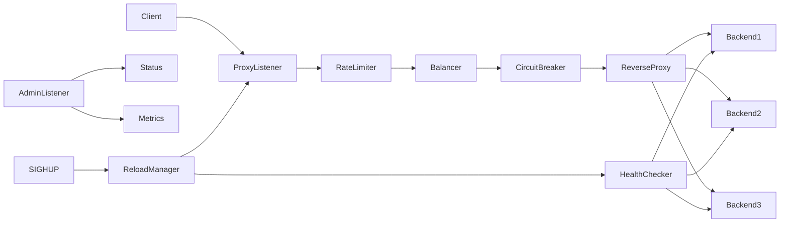

# loadbear architecture

Proxy requests are rate limited before the configured strategy selects a healthy backend whose circuit allows a request. An expired open circuit admits only one concurrent half-open probe. The reverse proxy forwards the request and tracks backend connection and request counters. GET, HEAD, and OPTIONS requests with no body or a replayable body may be retried on another backend after an upstream error, provided no response has been committed; retry attempts share the original request context.

The active health checker periodically requests the configured health path. It applies the configured consecutive-failure and consecutive-success thresholds to health-check results. A proxy error separately marks its backend unhealthy. The admin listener is separate from the proxy listener and serves only `/status` and `/metrics`.

On Linux and macOS, a serialized reload manager validates the startup config file after SIGHUP. It matches backends by URL, retains objects and their health/counter/circuit state for unchanged URLs, creates added backends, and removes dropped backends. Selection reads the backend list and strategy under a shared lock; reload swaps both under the exclusive lock, so each selection sees one complete version. Requests already using a removed backend finish normally. Metrics and the health checker receive updated backend snapshots. Other settings remain startup-only, and SIGHUP reload is unavailable on Windows.

## Components

- `internal/proxy`: proxy request handling, upstream transport, retry, and admin endpoint handlers.
- `internal/balancer`: round-robin, smooth weighted round-robin, least-connections, and IP-hash selection.
- `internal/backend`: backend health, connection counters, request counters, and circuit state.
- `internal/health`: periodic active HTTP health checks.
- `internal/ratelimit`: per-client token buckets.
- `internal/metrics`: status snapshots and hand-written Prometheus text output.
- `internal/config`: YAML defaults, environment overrides, and validation.

WebSocket-style upgrades are verified only for an HTTP/1.1 upgrade handshake and bidirectional raw-byte echo, not full RFC 6455 behavior. SIGHUP reload is unavailable on Windows. The admin listener defaults to loopback; Docker configuration explicitly binds it inside the container.
