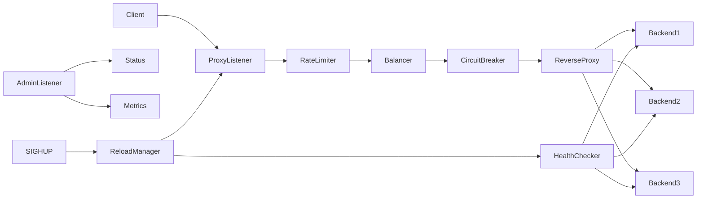

# loadbear architecture

Proxy requests are rate limited before the configured strategy selects a healthy backend whose circuit allows a request. An expired open circuit admits only one concurrent half-open probe. The reverse proxy forwards the request and tracks backend connection and request counters. GET, HEAD, and OPTIONS requests with no body or a replayable body may be retried on another backend after an upstream error, provided no response has been committed; retry attempts share the original request context.

The active health checker periodically requests the configured health path. It applies the configured consecutive-failure and consecutive-success thresholds to health-check results. A proxy transport error separately marks its backend unhealthy. Every upstream 5xx is a circuit failure by default; `proxy.circuit_failure_statuses` adds statuses to that rule rather than replacing it. These response statuses do not mark the backend unhealthy, and configured statuses may use the existing safe retry rules before the response is committed. The list is startup-only. `proxy.circuit_count_tunnel_errors` is an opt-in, startup-only feed that counts only upstream tunnel I/O errors toward a separate consecutive-error streak. Clean upstream closes never count because a normal WebSocket close handshake is indistinguishable from a clean backend close at the TCP level. The option does not retry or affect passive health, and leaves 101 handshake success behavior unchanged.

The metrics collector synchronizes global observations and backend-list snapshots. Request and tunnel-duration histogram buckets are cumulative and include `_sum` and `_count`; backend request/failure totals come from atomic backend counters, and active connections, active tunnels, and circuit state are synchronized. Tunnel close counters emit `client_closed`, `upstream_closed`, `upstream_error`, `shutdown_forced`, and `unknown`. `shutdown_forced` is explicit; the other endpoint-specific reasons are best-effort classifications of observed TCP EOFs or upstream I/O errors, while ambiguous outcomes map to `unknown`. Backend series are sorted and label-escaped, and removed backends disappear when reload replaces the metrics snapshot. The handler also tracks hijacked tunnels because `http.Server.Shutdown` does not wait for them: shutdown waits through the configured grace period, then closes remaining tunnels and waits for their cleanup.

On Linux and macOS, a serialized reload manager validates the startup config file after SIGHUP. It matches backends by URL, retains objects and their health/counter/circuit state for unchanged URLs, creates added backends, and removes dropped backends. Selection reads the backend list and strategy under a shared lock; reload swaps both under the exclusive lock, so each selection sees one complete version. Requests already using a removed backend finish normally. Metrics and the health checker receive updated backend snapshots. When any health-check setting changes, reload cancels and waits for the old checker loop before constructing and starting its replacement, so loops never overlap. Backend health flags survive because their objects are reused; the replacement checker starts fresh consecutive-check streaks. Canceled in-flight checks do not count as health failures. Other settings remain startup-only, and SIGHUP reload is unavailable on Windows.

## Components

- `internal/proxy`: proxy request handling, upstream transport, retry, and admin endpoint handlers.
- `internal/balancer`: round-robin, smooth weighted round-robin, least-connections, and IP-hash selection.
- `internal/backend`: backend health, connection counters, request counters, and circuit state.
- `internal/health`: periodic active HTTP health checks.
- `internal/ratelimit`: per-client token buckets.
- `internal/metrics`: status snapshots and hand-written Prometheus text output.
- `internal/config`: YAML defaults, environment overrides, and validation.

WebSocket-style upgrades are verified only for an HTTP/1.1 upgrade handshake and bidirectional raw-byte echo, not full RFC 6455 behavior. If both endpoints end a tunnel nearly simultaneously, the initiating side may not be distinguishable and the close reason is `unknown`. SIGHUP reload is unavailable on Windows. The admin listener defaults to loopback; Docker configuration explicitly binds it inside the container.
